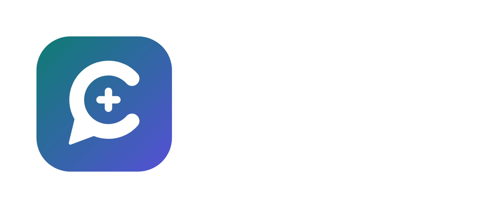

<p align="center">
  
</p>

<p align="center"><strong>A live medical interpreter in your pocket.</strong><br>
Patients and doctors speak their own language and understand each other, during the visit and after it.</p>

---

## Demo

[](https://youtu.be/TGTcA3AfFjA)

▶️ [Watch the demo on YouTube](https://youtu.be/TGTcA3AfFjA)

## About

**Clara** is a mobile-friendly web app that lets a doctor and a patient who don't share a language talk to each other by voice. Each person speaks in their own language and hears the other in theirs, read aloud in a natural voice. It works between any two of its 25 supported languages, so it isn't limited to English-speaking doctors: a Spanish-speaking doctor can treat a Nepali-speaking patient just as easily. After the visit, the doctor can send visit summaries, medication instructions, care instructions, and forms, and the patient receives them translated into their language. Uploaded PDFs come back as the same document with only the text translated, keeping the original layout.

Built for the **Lehigh Hackathon 2026**, *Reimagine Well-Being* track.

## Team

- **Agragyan Khanal**

## The problem

Millions of patients don't speak the language their doctor speaks. In the U.S. alone, more than 25 million people have limited English proficiency. For them, a routine visit can mean:

- **Not being understood.** Describing symptoms, history, or worries through gestures, a family member, or a child interpreting.
- **Not understanding.** Nodding along to a diagnosis or instructions they couldn't follow.
- **Going home with paperwork they can't read.** Discharge instructions, medication schedules, and warning signs written in a language they don't read.

And the gap isn't only with English. Doctors around the world practice in Spanish, French, Arabic, Russian, and many other languages, while their patients, often immigrants and refugees, speak something else entirely. Most interpretation tools assume one side speaks English.

Professional interpreters are the gold standard, but they're often unavailable on short notice, in small clinics, or for less common languages like Nepali, Somali, or Burmese. The result is misdiagnosis, medication errors, missed follow-ups, and patients who stop seeking care.

## The solution

Clara turns the patient's own phone into an interpreter, with nothing to install.

1. **Start a visit.** The doctor picks their own language and the patient's, and gets a QR code. The doctor's screen switches to their language.
2. **Patient joins.** They scan the code with their phone camera. The whole app, including every button and label, appears in their language.
3. **Talk by voice.** Either person taps the mic and speaks. Clara transcribes it, translates it, and reads it aloud on the other person's device. Both sides can see the original and the translation.
4. **Send documents home.** The doctor writes or dictates a summary, or uploads a PDF. The patient gets it in their language and can listen to it, print it, or reply with questions.

### Key features

- **Any language to any language.** The doctor and the patient each choose from 25 languages, including English, Nepali, Spanish, Mandarin, Arabic, Vietnamese, Haitian Creole, Somali, Amharic, and Burmese. Clara translates directly between the two, with no English in between.
- **Voice-to-voice conversation.** Speak naturally and the translation is read aloud on the other person's device.
- **Built for real speech.** Patients mix languages ("मलाई headache छ"), use slang, and get misheard by speech recognition. Clara reconstructs what was actually said before translating. It's told never to invent symptoms or soften what the patient says.
- **Layout-preserving PDF translation.** An uploaded discharge summary comes back as the same document, with the same logo, tables, colors, and fonts, in the patient's language. It works across scripts, from Devanagari, Arabic, and Telugu to Chinese, Amharic, and Burmese. Text is re-fitted so nothing overlaps or runs off the page.
- **Everyone sees the app in their own language.** Both the doctor's and the patient's interfaces are translated automatically. Patients get a large one-tap mic button in case they can't easily read or type.
- **Real-time sync** between devices, with live status ("Patient is speaking…", "Translating…").
- **Accessible by design.** Mobile-first, works in light and dark mode, reads every message aloud, and can print documents to take home.

## Technologies used

| Area | Technology |
|---|---|
| **Translation and reasoning** | [Claude API](https://docs.anthropic.com) (Anthropic). **Claude Sonnet 5.5** reconstructs and translates patient speech; **Claude Haiku 5.5** translates doctor messages, documents, PDFs, and both interfaces |
| **Speech to text** | [Groq](https://groq.com) Whisper large-v3, with optional [ElevenLabs Scribe](https://elevenlabs.io) |
| **Text to speech** | [ElevenLabs](https://elevenlabs.io) multilingual voices (Google Translate TTS as a fallback) |
| **Backend** | Node.js, Express, Server-Sent Events for real-time updates, Multer for uploads |
| **PDF translation** | Python with [PyMuPDF](https://pymupdf.readthedocs.io) to extract text, remove it, and re-typeset the translation; fontTools for font subsetting; Google Noto fonts for every script |
| **Frontend** | HTML, CSS, and vanilla JavaScript (no build step), Web Audio API and MediaRecorder for voice capture |
| **Other** | `qrcode` for visit invites, `selfsigned` for local HTTPS so phones can use the microphone over Wi-Fi |

## Running locally

**Requirements:** Node.js 18+ and Python 3.9+

```bash
npm install
python3 -m venv .venv && .venv/bin/pip install -r requirements.txt
cp .env.example .env   # then add your API keys
npm start
```

Open **http://localhost:3000**. To join from a phone on the same Wi-Fi, scan the QR code on the doctor's screen. The first time, accept the browser's security warning; it appears because the local HTTPS certificate is self-signed.

| Environment variable | Purpose |
|---|---|
| `ANTHROPIC_API_KEY` | Translation (required) |
| `GROQ_API_KEY` | Speech to text |
| `ELEVENLABS_API_KEY` | Natural voices (enable **Text to Speech**, and **Speech to Text** for better accuracy) |
| `PUBLIC_URL` | Optional public https URL for QR codes once deployed |

> Clara is a hackathon prototype. Translations are produced by AI and can contain mistakes. For critical medical decisions, confirm with a qualified medical interpreter.
